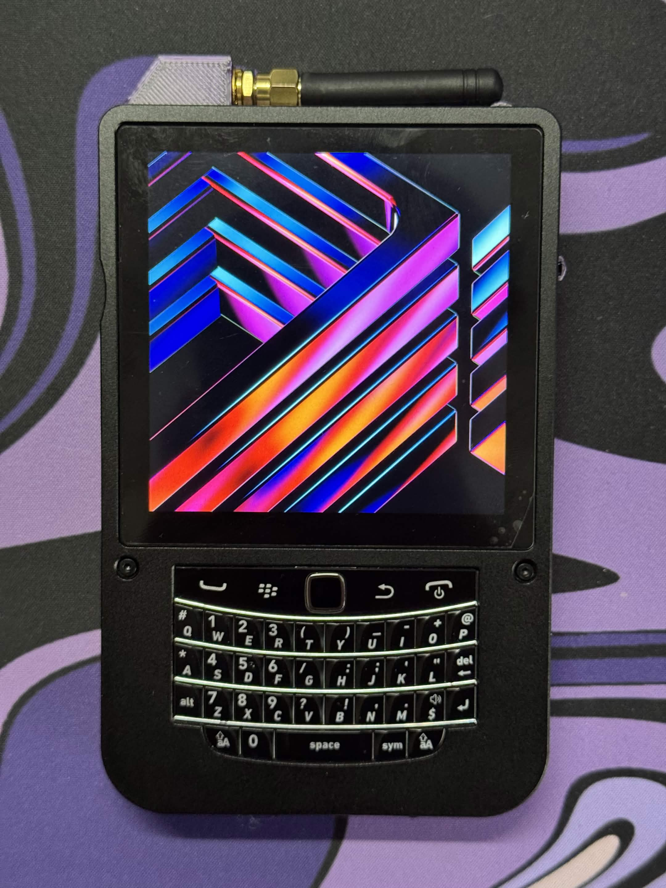
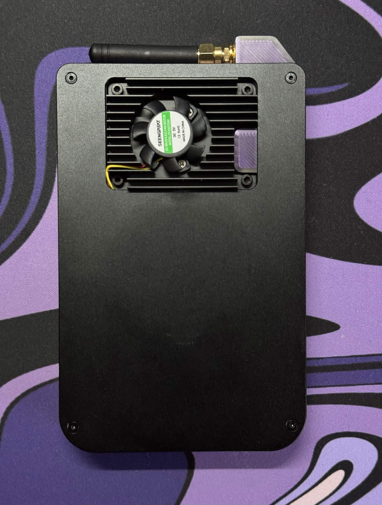
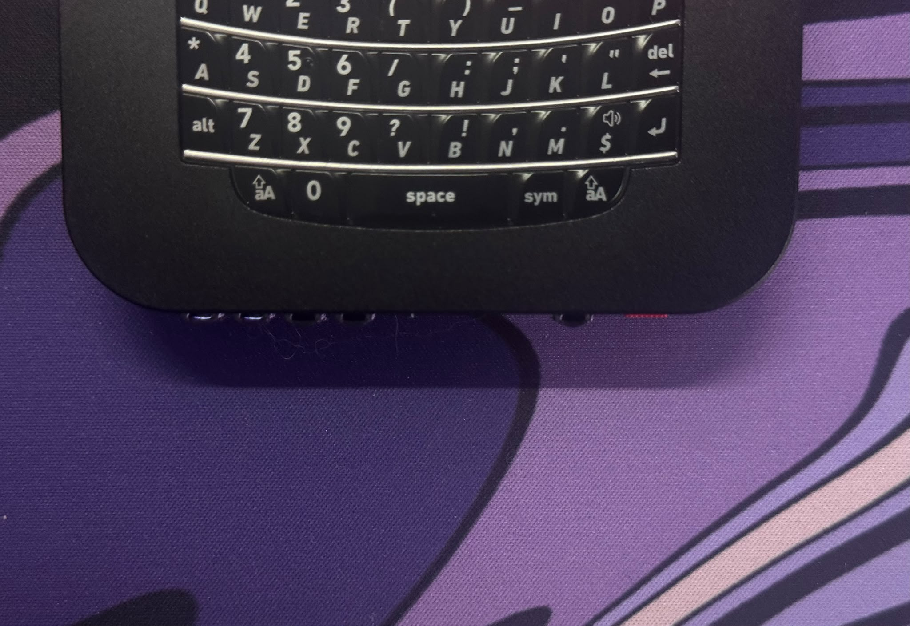

# 3D Files

Printable / CAD parts for the Hackberry Pi CM5 — cases, mounts, and other accessories.

Files for this device live here as they’re added (STL, STEP, etc.). Upstream hardware and case designs also appear in the [official Hackberry Pi CM5 repo](https://github.com/ZitaoTech/HackberryPiCM5).

- [Heatsink](https://www.printables.com/model/1395441-hackberrypi-cm5-heatsink-cover/files) for Seengreat fan by [Symbiiote](https://www.printables.com/@Symbiiote_1168021)

- [BackPlate](https://github.com/mimi-umpc/HackberryPi-CM5-Lowercase) by [mimi-umpc](https://github.com/mimi-umpc)

My own custom version with photos below:
[Download model here](https://www.printables.com/model/1865492-hackberry-pi-cm5-antenna-mod) 

Antenna Mod: Added small front light boxes for visibility, introduced front-facing windows to see device indicators, and installed a protective cover over the board’s antenna.

### *IMPORTANT- YOU NEED TO PAUSE PRINTING TO PLACE THE ANTENNA*
Pause printing before printing the cover part for the antenna, otherwise you will not be able to place it.

## Photos

