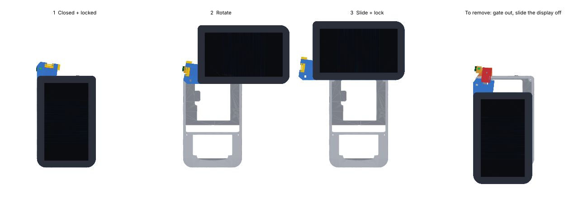
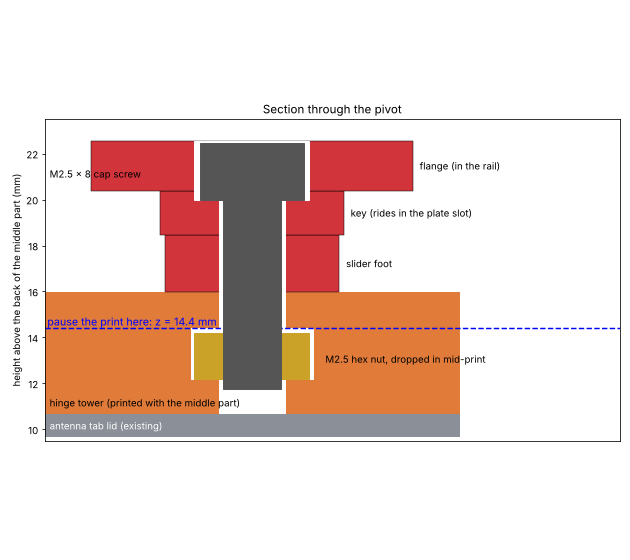
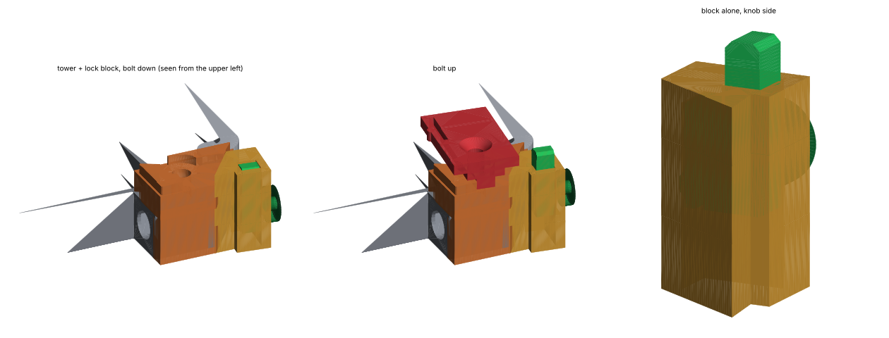
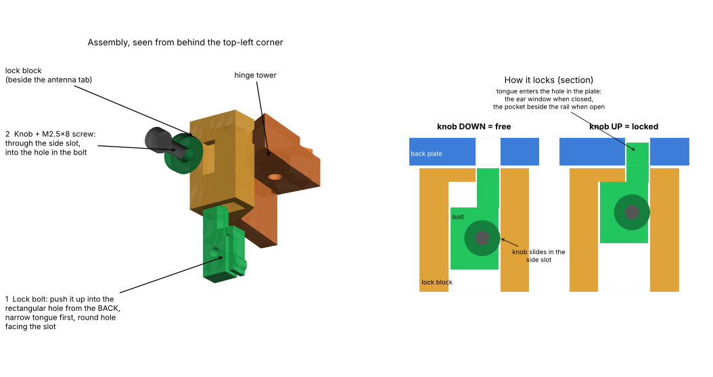
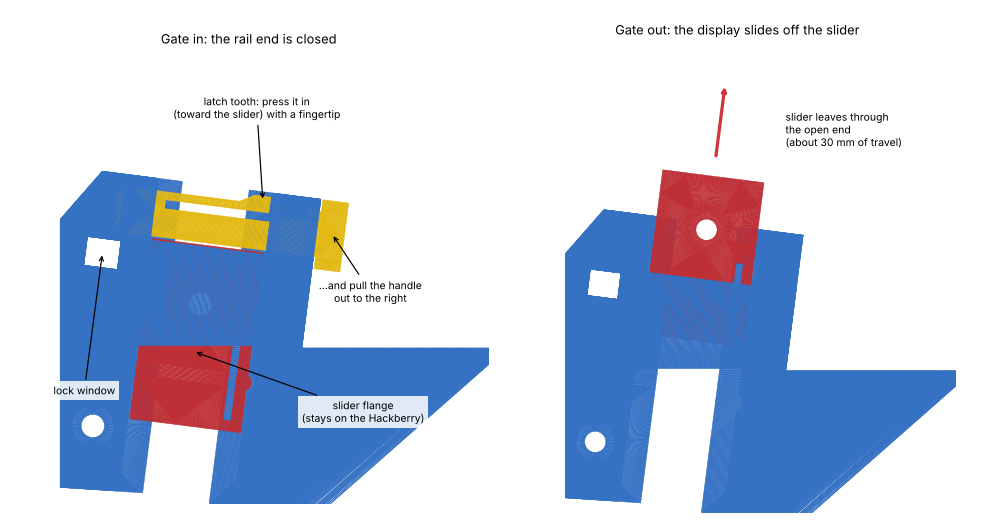

# HackberryPi CM5 swivel-slide display: design notes (v4)

This replaces the built-in screen view with a Waveshare 5.5" 1440×2560 LCD (glass 140.40 × 74.76 mm, 8.70 mm deep), mounted on a HackberryPi CM5.

- **Closed:** the display covers the Hackberry in portrait.
- **Open:** it rotates 90° about a pivot on the antenna tab and slides so the HDMI edge sits on top.
- **Removal:** the whole display lifts off without unscrewing anything.

## What you need first

| Item | Notes |
| --- | --- |
| HackberryPi CM5 | Standard middle part (`hpi_cm5_with_whole_cover_and_fan_cover`) and the **9900 Uppercase** top cover. Other variants are not tested. |
| Waveshare 5.5" 1440×2560 LCD | HDMI + USB capacitive touch version: <https://www.waveshare.com/product/5.5inch-1440x2560-lcd.htm> |
| Base 3D files | From Zitaotech's HackberryPi CM5 repository: `[add link]`. File 1 here is a modified version of the original middle part. |

## Motion

| State | What happens |
| --- | --- |
| **Closed** | The display sits portrait over the Hackberry (same 91.77 × 143.47 mm footprint) and is locked. |
| **Rotate** | Put the knob down to unlock, then rotate 90° about the pivot. |
| **Open** | Slide about 49 mm left along the tilted rail until it stops (HDMI edge on top), then put the knob up to lock again. |
| **Remove** | Take the gate out and slide the display about 30 mm off the slider. The slider stays on the Hackberry. |

- The pivot is at `(-41.5, 61.4)` in the middle-part STL frame.
- The rail is tilted **7.3°** in the back plate.

## Parts to print

All parts print **in the orientation the STL is exported in**, with **no supports**. Use 0.2 mm layers, at least 3 walls, and 20 % infill or more. PLA works; PETG is recommended for part 6.

| # | File | Bed side | Role / notes |
| --- | --- | --- | --- |
| 1 | `1_middle_part_with_tower_and_lock_block.stl` | as the original part | Middle part with the hinge tower and the lock block (left of the antenna tab). A **captive M2.5 hex nut** goes in mid-print: **pause at z = 14.4 mm**. |
| 2 | `2_display_case.stl` | display front (bezel) | 15 mm deep case. Glass pocket 140.90 × 75.26 mm. Four bosses for M2.5 heat-set inserts (3.2 mm hole, 5 mm deep). |
| 3 | `3_display_back_plate.stl` | device side | 4 mm back plate: rail open at the ear end, six hold-down posts, counterbored M2.5 holes. The roof over the rail prints as a bridge. The file contains **overlapping bodies**; most slicers merge them automatically, but in Cura turn on *Union Overlapping Volumes*. |
| 4 | `4_hinge_slider_m2_5.stl` | flange | Hinge slider, counterbored for an M2.5 cap or pan head. Use 3+ walls. |
| 5 | `5_lock_bolt_and_knob.stl` | flat | Lock bolt and knob (two pieces on one plate). |
| 6 | `6_rail_gate.stl` | flat | Rail gate that closes the rail end. Its latch arm is 1 mm thick and must flex: **PETG** recommended. |

Preview-only STLs (not for printing): `assembly_closed_preview_only.stl`, `assembly_removed_preview_only.stl`.

> If you printed an earlier middle part without the lock block, an optional glue-on block (`1b_lock_block_glue_on.stl`) exists. Glue it to the slanted face of the antenna tab, flush with the back. **Do not print it if you use file 1**, which already includes the block.

## Hardware

Everything is M2.5, so one small M2.5 assortment kit covers it.

| Qty | Part | Where it goes |
| --- | --- | --- |
| 4 | M2.5 × 6 mm button-head screw (ISO 7380) | Back plate to display case |
| 4 | M2.5 × 4 mm heat-set insert, 3.5 mm outer diameter | Display case corners |
| 2 | M2.5 × 8 mm socket cap screw (DIN 912) | One for the pivot, one for the lock knob |
| 1 | M2.5 hex nut (DIN 934, 5 mm across the flats) | Dropped into the tower mid-print |

- **Case screws:** buy button heads. A socket cap head is 2.5 mm tall and would stick about 0.5 mm out of its 2 mm recess on the side facing the Hackberry. That still clears, but a button head sits flush.
- **Pivot screw:** don't go longer than 8 mm, or it hits the lid of the antenna tab before it tightens.
- **Pivot nut:** use a plain nut, not a nyloc, which is too tall for the pocket.
- **Spares:** these parts are easy to lose, so a kit with a few of each is worth it.

### Tools

- Soldering iron with a heat-set insert tip (or a clean conical tip)
- 2 mm hex key (socket cap screws) and 1.5 mm hex key (button-head screws)
- Blue (medium-strength) threadlocker

## Assembly

1. **Print part 1 with the nut.** Pause at z = 14.4 mm, drop the M2.5 hex nut flat into the hexagonal pocket, and resume. With a layer height other than 0.2 mm, pause just before the first layer that closes the pocket.
2. **Inserts.** Melt the four M2.5 × 4 heat-set inserts into the case bosses, flush with the top.
3. **Display into the case.** Place the display glass-down into the case, with the HDMI / headphone / power edge against the long side opening and the touch micro-USB toward the short-end opening.
4. **Back plate.** Fit the back plate so the rim sits inside the case and the six posts press on the display's standoffs. Screw it on with the four M2.5 × 6 button-head screws.
5. **Slider.** Drop the slider's flange into the rail from the inside of the back plate if it isn't attached yet. Otherwise go straight to step 6.
6. **Pivot.** Put the slider on the hinge tower and fasten it with the M2.5 × 8 cap screw into the captive nut. Add a drop of threadlocker and tighten until the display turns with light friction, **not fully tight**.
7. **Lock.** See [Lock](#lock).
8. **Gate.** Slide the display onto the slider and push the gate in until it clicks. See [Rail gate](#rail-gate-removal).

## Pivot (captive nut)

- **Screw:** M2.5 × 8 cap head into a standard M2.5 hex nut (5.0 mm across the flats, 2.0 mm thick), held captive in the tower.
- The hexagonal pocket stops the nut from turning. A 1.6 mm printed roof over the nut is what the screw pulls against.

## Lock

1. Push the **lock bolt** into the block from the **back** of the Hackberry, narrow tongue first, with the round hole facing the side slot.
2. Put the **M2.5 × 8 screw** through the knob, then through the side slot, into the hole in the bolt. The hole is 2.1 mm, so the screw **self-taps** into the plastic. Tighten until it bottoms out, then stop: the bolt must still slide freely. The screw also keeps the bolt captive.

| Knob | Result |
| --- | --- |
| **Down** | Free. The tongue is clear of the back plate. |
| **Up** | Locked. The tongue enters the square window in the ear (closed) or the pocket beside the rail (open). |

## Rail gate (removal)

The gate is a 5.7 × 2.2 mm bar that slides sideways through the ear and closes the rail end. A sprung tooth latches behind the right-hand wall of the opening. The gate is also the end stop in the closed position; when the device is held upright the load pushes it against solid walls, not against the latch.

**To remove the display**

1. Unplug the HDMI and USB cables.
2. Put the lock knob down.
3. Press the latch tooth in (toward the slider) and pull the gate out by its handle.
4. Slide the display about 30 mm off the slider. The slider stays screwed to the Hackberry.

**To refit:** slide the display back onto the slider, push the gate in until it clicks, and lock.

## Case openings

- **HDMI edge (long side):** one opening, about 61 mm, covering the headphone jack, HDMI and power.
- **Short end next to the touch port:** 15 mm opening for the touch micro-USB plug.
- The case is 15 mm deep, which leaves about 9 mm above the board for plug bodies.

## If it doesn't fit

Adjust the clearances in CAD; **don't scale the whole part**, which changes the screw holes and the rail too.

| Feature | Designed clearance |
| --- | --- |
| Glass pocket | 0.25 mm per side |
| Slider in the rail | 0.2–0.3 mm |
| Nut pocket | 5.3 mm across the flats (nut is 5.0 mm) |
| Insert holes | 3.2 mm for 3.5 mm inserts |
| Lock tongue | 0.1–0.2 mm |

If the gate's latch arm snaps, print it in PETG; if it still fails, the arm needs to be longer.

## Known limitations

- The display part adds **19 mm** of thickness and sits about 3 mm above the Hackberry's front.
- The lock knob sticks out about 1.5 mm past the left side, plus the screw head.
- When locked there is under 1° of rotational play, about 2 mm at the far end of the display.
- The open-position lock grips only the 1.6 mm bottom layer of the back plate. It is fine for normal use, not for a drop.
- When open, the display covers the top 2.1 mm of the Hackberry screen opening.

## Assumptions to re-check

- Connector and standoff positions were measured from photos (about ±1 mm).
- The top cover is 5.0 mm thick and sits on the frame wall top (front face at z = 15.66 mm in the middle-part frame).

## Changelog

| Version | Change | Parts affected |
| --- | --- | --- |
| v1 | First swivel-slide hinge: tower, slider and back plate for the original display holder. | — |
| v2 | New display case with the Hackberry's exact footprint; hinge re-fitted to it. | 1, 2, 3, 4 |
| v3 | Case 15 mm deep; M2.5 heat-set inserts; new HDMI and touch openings; hold-down posts; lock bolt. Pivot changed to M2.5 with a captive hex nut. | 1, 2, 3, 4, 5 |
| v4 | Rail end opened and closed by a removable latching gate, so the display can be taken off. | 3, 6 (new) |