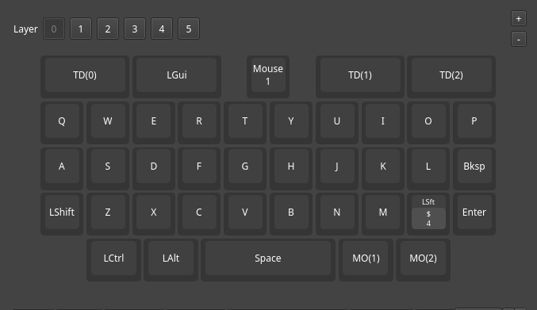
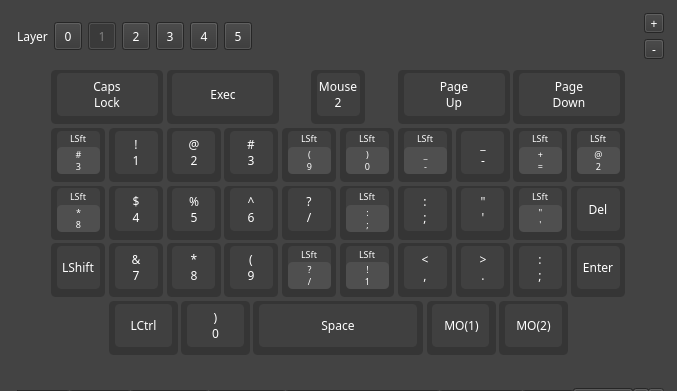
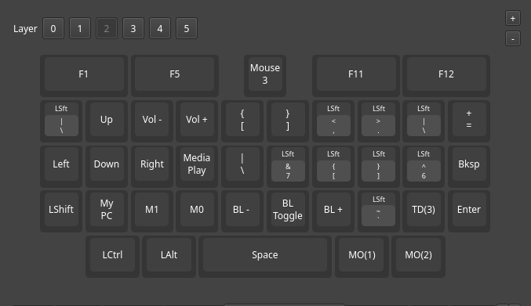

# Hackberry Pi CM5 — Modified Linux Layout  
Custom key‑layer configuration for the Zitaotech's  [Hackberry Pi CM5](https://github.com/ZitaoTech/HackberryPiCM5/tree/main), focused on improving Linux terminal workflows and system control.

---

## Layer2 Additions (Linux‑Optimized)

- **Ctrl+Shift+C** — assigned to **C key in layer 2**   
  Standard Linux terminal copy shortcut.

- **Ctrl+Shift+V** — assigned to **X key in layer 2**  
  Standard Linux terminal paste shortcut.

- **Middle Click** — assigned to **Mouse Click in layer 2**  
  Useful for closing tabs or pasting primary selection.

- **Open Files** — assigned to **Z key in layer 2**  
  Quick access to the file manager.

- **Volume Down** — assigned to **E key in layer 2**

- **Volume Up** — was assigned to **R key in layer 2**. [`script_play.vil`](script_play.vil) uses that key for **Script play**. Put volume up on another key in Vial if you still want it.

- **Media Play/Pause** — assigned to **F key in layer 2**

## Layout Images






---

## Script replay

The CM5 copies one script into the RP2040 while the left switch is **internal**. After you flip that switch and plug the bottom USB-C into another computer, the same controller shows up there as a USB keyboard (`4242:0003`). Plugging the cable in does not type anything. Hold **Script play** for about 400 ms to start. Press it again to stop.

Do these in order: flash the firmware, check the keyboard, load the layout, set up the app, then send a script.

### Safety

Flashing does not write the CM5. The UF2 goes only to the RP2040, the separate chip that scans the BlackBerry keys. `flash.py` copies that file onto a drive labelled `RPI-RP2`. It does not touch the CM5's SD card, NVMe, or boot firmware. Building with `build.sh` only compiles.

The RP2040's USB bootloader is in ROM on the chip, so a normal UF2 cannot erase it. A bad or interrupted flash can leave the keyboard dead until you recover it. It does not brick the Hackberry itself. If `$` no longer enters the bootloader, open the case, hold the RP2040 BOOTSEL button, and connect USB. `RPI-RP2` appears again. Use the recovery steps below, or `python3 Keyboard/firmware/flash.py restore`, to put the stock image back.

Loading `script_play.vil` and changing the USB name only affect the keyboard controller. VID and PID stay `4242:0003`.

Playback is the risk to this machine. The script does not run when you plug the cable in. It runs when **Script play** (layer 2, **R**) is held for about 400 ms. If the left switch is still **internal**, those keystrokes go to the Hackberry. A script that types into a focused terminal can change or wipe files on the CM5. Flip the switch to **external** before holding that key, so the keystrokes go to the other computer.

### 1. Flash the RP2040 from the Hackberry

Flash from the CM5. The left switch stays **internal**, so the RP2040's USB stays on the Hackberry and the `RPI-RP2` drive shows up there. The bottom USB-C is not used for this.

From the repo root:

```bash
python3 Keyboard/firmware/flash.py
```

Choose **1**. The menu builds `Keyboard/firmware/build/hackberry_cm5_vial.uf2` if you confirm, then waits. Hold `$` until `RPI-RP2` appears. A short tap of `$` still types `$`. On a fresh keymap the boot key is layer 2, row 5, column 4. Confirm the copy. The tool writes the UF2 and waits until the drive disappears.

The same steps without the menu:

```bash
python3 Keyboard/firmware/flash.py flash
```

The build needs the ARM GCC and QMK virtualenv already present under `Keyboard/firmware/.toolchain`. The script slot at flash offset `0x1EE000` is left alone, so a later reflash keeps a script that was already stored.

Leave the switch internal. Check typing, the trackpad, the backlight, and Vial on the CM5. If the matrix is dead or scrambled, stop and use the recovery steps at the bottom. If `RPI-RP2` never appears, the switch is on the other side, or the drive did not mount. The tool only copies a drive mounted on this computer. You can still copy the UF2 by hand onto the path where the file manager opened `RPI-RP2`, often `/run/media/$USER/RPI-RP2/`.

#### Flash from another computer

Menu option **3** prints these steps. The assistant cannot copy a drive that is mounted on the other machine. Use this only when the UF2 should be copied from that machine. The switch chooses the host before you enter the bootloader. Flipping it while `RPI-RP2` is already mounted moves the drive to the other side.

1. Copy `Keyboard/firmware/build/hackberry_cm5_vial.uf2` onto the other computer while the switch is still internal (for example with `scp`). The build can stay on the CM5.
2. Flip the left switch to **external**.
3. Plug the bottom USB-C into the other computer. It enumerates as a keyboard first.
4. Hold `$` (or the fresh-keymap boot key) until `RPI-RP2` appears on that computer. It does not appear on the Hackberry.
5. Copy the UF2 onto `RPI-RP2` there. The drive disappears when the flash finishes.
6. Flip the switch back to **internal** before Vial, the keyboard check, or the script app. Those talk to the RP2040 only while it is connected to the CM5.

### 2. Put Script play on a key

The key is layer 2, the **R** key, in [`script_play.vil`](script_play.vil). A keymap already saved in EEPROM does not gain that key from the UF2 alone.

1. Install [Vial](https://get.vial.today/) on the CM5.
2. Left switch still internal.
3. In Vial, **File → Load saved layout**, and choose `Keyboard/script_play.vil`.

After that, hold layer 2 and hold **R** for about 400 ms to play. A second press stops playback. Volume up used to be on that key; assign it somewhere else in Vial if you still want it.

### 3. Set up the loader once

From the repo root:

```bash
cd Keyboard/script-replay
python3 -m venv .venv
.venv/bin/pip install -r requirements.txt
sudo cp 99-hackberry-script.rules /etc/udev/rules.d/
sudo udevadm control --reload
sudo udevadm trigger
```

The udev rule lets your user open raw HID interface 1. The boot keyboard stays with the kernel. Until the rule is installed, the tool fails with `claim failure`. Your user needs to be in the `users` group, which is what the rule grants access to.

### 4. Where the scripts are

The tool reads **one file path**. It does not scan a folder.

| Path | What it is |
| --- | --- |
| `Keyboard/script-replay/scripts/` | Your scripts. Put `.txt` files here. |
| `Keyboard/script-replay/examples/` | The two samples shipped with the repo. |

Run the tool from `Keyboard/script-replay`, and pass a path relative to that directory:

- `scripts/myscript.txt`
- `examples/hello.txt` — one-line greeting
- `examples/signoff.txt` — short sign-off

`examples/hello.txt` is a one-line greeting. Menu option **7 list** lists USB devices at `4242:0003`. It does not list files.

A script is plain text. The Pi expands it; the controller stores key down, key up, and delay events, up to 32 KB of those events. The gap between characters is 10 ms. Lines starting with `#` are ignored.

```
STRING Hello from the Hackberry.
ENTER
DELAY 200
CTRL-c
REPEAT 2
STRING Again.
ENDREPEAT
```

Also accepted: `TAB`, `SPACE`, `BACKSPACE`, `ESC`, `DELETE`, `UP`, `DOWN`, `LEFT`, `RIGHT`, and `ALT-`, `SHIFT-`, `GUI-`, or `WIN-` chords.

### 5. Send a script

Left switch internal. From `Keyboard/script-replay`:

```bash
.venv/bin/python hackberry_script.py ping
.venv/bin/python hackberry_script.py send scripts/myscript.txt
.venv/bin/python hackberry_script.py verify scripts/myscript.txt
```

`ping` should print a status line. `send` prints progress. `verify` checks length, CRC, and a read-back. A missing device, a claim failure, a short write, a bad CRC, or an ACK timeout is printed as that error.

With no arguments the same actions are a menu:

```bash
.venv/bin/python hackberry_script.py
```

| Key | Action |
| --- | --- |
| 1 | ping |
| 2 | status |
| 3 | send — asks for a script file path |
| 4 | verify — asks for the same path |
| 5 | clear the slot |
| 6 | USB identity |
| 7 | list USB devices |
| q | quit |

For menu option 3 or 4, type the path, for example `scripts/myscript.txt` or `examples/hello.txt`.

### 6. Play it on the other computer

Flip the left switch to **external** before holding **Script play**. With the switch still internal, the same key types into the Hackberry.

1. Flip the left switch to the external position.
2. Plug the bottom USB-C into the other computer. Nothing is typed on connect.
3. Hold layer 2, then hold **R** (**Script play**) for about 400 ms.
4. Press **Script play** again to stop.

An empty slot does nothing. To load a different script, flip the switch back to internal and run `send` again.

### USB name

Manufacturer and product strings can be changed from the Pi. They show up on the other computer after the next switch flip, because that flip re-enumerates the controller. VID and PID stay `4242:0003`. Names are up to 28 printable ASCII characters. Logitech, Dell, Apple, Microsoft, and HP are rejected.

```bash
.venv/bin/python hackberry_script.py identity --manufacturer "Cedar Labs" --product "Field Keyboard"
.venv/bin/python hackberry_script.py identity --random
.venv/bin/python hackberry_script.py identity --reset
```

`--random` picks a fictional label, such as `Cedar Labs` / `Field Board K240`.

### Recovery

Recover from the same host that will see `RPI-RP2`. With the switch internal, that is the Hackberry. With the switch external and the bottom USB-C plugged into another computer, that is the other computer.

On the Hackberry, menu option **2** in `python3 Keyboard/firmware/flash.py` copies the stock image after you hold `$` and confirm. From the command line:

```bash
python3 Keyboard/firmware/flash.py restore
```

By hand, hold the boot key (`$` on the old EEPROM layout) until `RPI-RP2` appears, and copy the stock image onto that drive:

```bash
cp "Zitao Repository/Keyboard/HackberryPi_CM5_9900.uf2" /run/media/$USER/RPI-RP2/
```

Same mount note as the flash step: if `RPI-RP2` is not under `/run/media/$USER/`, copy onto the path the file manager shows. On another computer, copy `Zitao Repository/Keyboard/HackberryPi_CM5_9900.uf2` from whatever path you transferred it to.

If the boot key cannot be pressed, open the case and hold the RP2040 BOOTSEL button while the USB host connects, then copy that same stock UF2 onto `RPI-RP2`. For the Hackberry, the switch is internal and the internal USB link is already present, so hold BOOTSEL and reset the controller. For another computer, flip the switch to external, hold BOOTSEL, and plug in the bottom USB-C. Leave the `Zitao Repository` folder unchanged. After an external recovery, flip the switch back to internal before using the keyboard on the CM5.

More detail is in [`script-replay/README.md`](script-replay/README.md).

---


